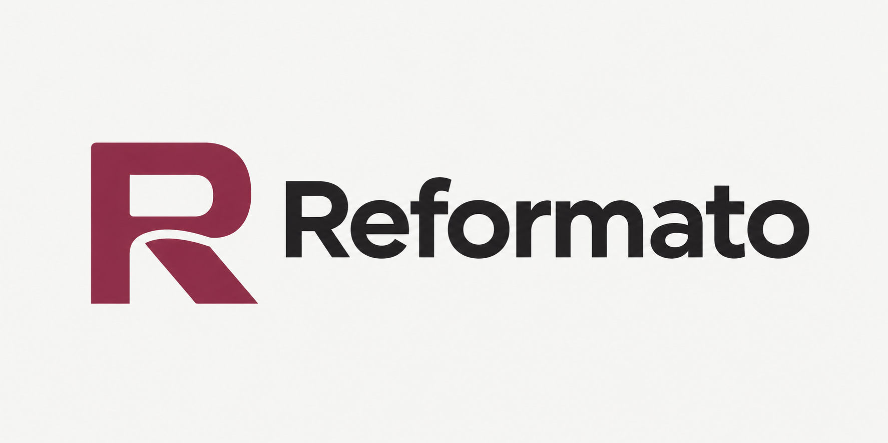
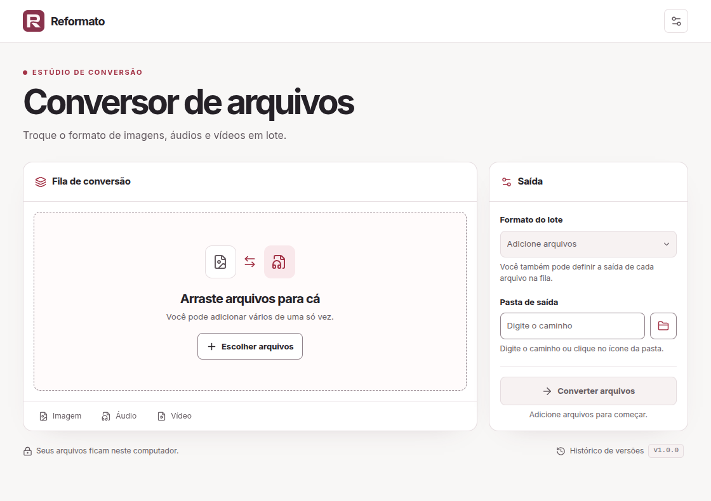
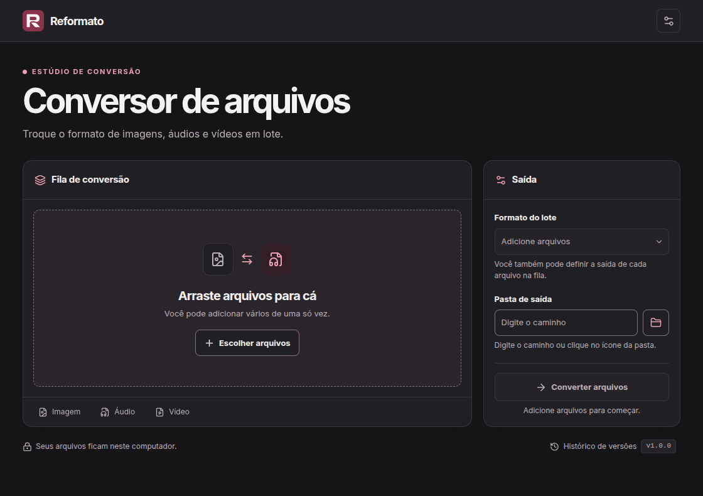
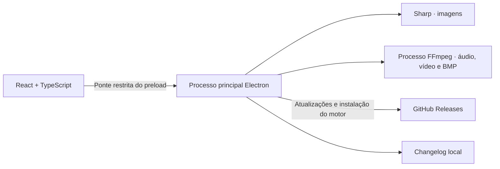

<p align="center">
  
</p>

<h1 align="center">Reformato</h1>
<p align="center"><strong>Converta imagens, áudios e vídeos em lote, no seu computador.</strong></p>
<p align="center">
  <a href="https://github.com/kelvinmattosdev/Reformato/releases/latest"></a>
  <a href="https://github.com/kelvinmattosdev/Reformato/actions/workflows/build.yml"></a>
  
</p>
<p align="center">
  <a href="https://github.com/kelvinmattosdev/Reformato/releases/latest"><strong>Baixar o Reformato</strong></a>
  · <a href="#como-usar">Como usar</a>
  · <a href="#formatos-compatíveis">Formatos</a>
  · <a href="CHANGELOG.md">Histórico</a>
</p>

O Reformato reúne tarefas como reduzir uma imagem para JPG, extrair o áudio de um vídeo ou converter uma pasta de clipes. Adicione vários arquivos, escolha a saída e acompanhe o lote sem enviar sua mídia para um servidor. Os originais não são alterados.

<table>
  <tr>
    <td></td>
    <td></td>
  </tr>
</table>

## Instalação

Na [release mais recente](https://github.com/kelvinmattosdev/Reformato/releases/latest), escolha o pacote do seu sistema:

| Sistema | Arquivo | Como abrir |
| --- | --- | --- |
| **Windows 10 ou 11, 64 bits** | `Reformato-Setup-…-x64.exe` | Abra o instalador e siga as etapas. Esta versão não tem assinatura digital do Windows. |
| **Linux, 64 bits** | `Reformato-…-linux-x64.AppImage` | Dê permissão de execução e abra. O AppImage é portátil e não cria atalho no menu. |
| **Debian, Ubuntu, Zorin OS e derivados, 64 bits** | `reformato_…_amd64.deb` | Instale pelo gerenciador de pacotes e busque **Reformato** no menu de aplicativos. |

No terminal, na pasta onde foi feito o download:

```bash
# Linux: AppImage
chmod +x Reformato-1.0.0-linux-x64.AppImage
./Reformato-1.0.0-linux-x64.AppImage

# Debian, Ubuntu ou Zorin OS: pacote DEB
sudo apt install ./reformato_1.0.0_amd64.deb
```

Se o AppImage não abrir por falta de FUSE, use `./Reformato-1.0.0-linux-x64.AppImage --appimage-extract-and-run` ou escolha o pacote DEB em uma distribuição compatível.

### Motor de conversão

Na primeira conversão de **áudio, vídeo ou BMP**, selecione **Baixar motor de conversão**. O Reformato baixa o FFmpeg uma vez (~80 MB) e verifica seu SHA-256. Depois disso, as conversões funcionam offline. Para as outras conversões de imagem, não é necessário baixar o motor. Também é possível instalá-lo em **Configurações → Motor de conversão**.

## Como usar

1. **Adicione os arquivos.** Arraste-os para a fila ou clique em **Escolher arquivos**.
2. **Escolha a saída.** Defina um formato por arquivo ou aplique um formato compatível a todo o lote. Para extrair áudio de um vídeo, escolha uma das opções na seção **Áudio**.
3. **Informe a pasta de saída.** Digite ou cole o caminho completo, ou abra o seletor pelo ícone de pasta.
4. **Converta.** Acompanhe cada item na fila e use **Abrir última pasta** para ver o resultado. Se o nome já estiver em uso, o Reformato acrescenta `(1)`, `(2)` e assim por diante.

Na fila vazia, passe o mouse ou use **Tab** em **Imagem**, **Áudio** ou **Vídeo** para consultar as extensões. Em **Configurações**, escolha tema claro, escuro ou do sistema.

## Formatos compatíveis

| Categoria | Extensões de entrada |
| --- | --- |
| **Imagem · 9** | PNG, JPG/JPEG, WebP, AVIF, BMP, TIFF/TIF e GIF estático |
| **Áudio · 30** | WAV, MP3, FLAC, OGG/OGA, M4A, AAC, AC3, AIFC, AIFF/AIF, AMR, AST, AU/SND, CAF, DTS, EAC3, LATM/LOAS, M4B, MKA, MP2, Opus, SBC, SPX, TTA, VOC, WMA e WV |
| **Vídeo · 31** | MP4, WebM, MOV, MKV, 3GP, 3G2, AVI, DV, F4V, FLV, IVF, M4V, MPG/MPEG/MPE, MXF, NUT, OGV, VOB, WMV/ASF, M1V, M2V, MJPEG/MJPG, H264, H265/HEVC, AV1/OBU e Y4M |

- A saída depende das faixas e do formato de entrada. O seletor não oferece o mesmo formato de entrada só com outra extensão.
- **WebP → PNG ou JPG.** Para criar um WebP, use PNG ou JPG/JPEG como entrada.
- **Vídeo → áudio** exige uma faixa de áudio. **Áudio → MP4** cria um MP4 que contém só som.
- Formatos brutos como H264, H265, AV1/OBU e Y4M não levam áudio. A lista de formatos não é uma promessa de que todo codec ou arquivo com aquela extensão poderá ser lido.

## Atualizações e privacidade

O app consulta o **GitHub Releases**. No AppImage gravável e no instalador Windows, clique em **Atualizar para vX.Y.Z** para baixar e instalar. No pacote DEB, o app abre a página da nova release para instalação manual. Depois de atualizar, o app mostra o que mudou. O histórico completo fica no rodapé.

A conversão é local, sem conta, envio de mídia ou telemetria. O app acessa a rede para consultar ou baixar atualizações e, com sua confirmação, para instalar o motor de conversão.

## Arquitetura



A interface trabalha com identificadores dos arquivos selecionados; o processo principal mantém seus caminhos e grava as saídas sequencialmente.

| Caminho | Responsabilidade |
| --- | --- |
| `src/` | Interface, temas e contrato TypeScript da ponte de desktop. |
| `electron/` | Janela, seletores, fila, instalação do motor e atualizações. |
| `shared/media-formats.json` | Extensões, contêineres e codificadores que o app oferece. |
| `scripts/` e `test/` | Ícones, empacotamento e testes de conversão, temas e histórico. |
| `docs/` | Marca, capturas reais do aplicativo e notas de distribuição. |

## Desenvolvimento

Com **Node.js 22.12+ ou 24** e npm:

```bash
npm ci
npm run check
npm start
```

| Comando | Resultado |
| --- | --- |
| `npm run dist:linux` | AppImage, DEB e metadados de atualização em `release/`. |
| `npm run dist:win` | Instalador NSIS, blockmap e metadados em `release/`. Execute no Windows. |
| `REFORMATO_FULL_MATRIX=1 npm test` | Executa também a matriz completa de áudio e vídeo (sintaxe Linux). |

Os testes padrão gravam, abrem e reimportam amostras das extensões. O workflow [Build desktop](.github/workflows/build.yml) gera e valida os pacotes nativos. Para publicar, consulte [Distribuição](docs/distribuicao.md).

## Limitações

- SVG editável, imagens animadas, imagens com várias páginas e entradas TS/MTS/M2TS não são suportados nesta versão.
- JPG/JPEG e BMP achatam transparência sobre branco. Vídeos mantêm a primeira faixa de vídeo e a primeira de áudio, quando compatíveis com a saída; legendas não são copiadas.
- Presets com requisitos rígidos, como DV e AMR, podem ajustar resolução, taxa de quadros ou parâmetros do áudio.
- Não há pacote macOS nesta versão. `npm start` é para desenvolvimento e não instala atualizações.

## Documentação

- [Histórico de versões](CHANGELOG.md) · [Avisos de terceiros](THIRD_PARTY_NOTICES.md)
- Marca: [assinatura original](docs/brand/reformato-assinatura.jpg) · [ícone SVG](public/reformato.svg) · [ícone PNG de 1024 px](docs/brand/reformato-icone.png)
